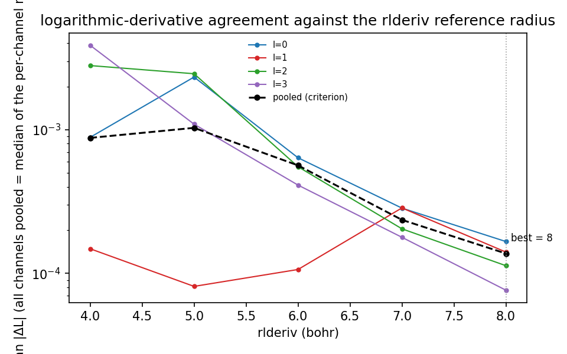

# uranium-14ve-6p25: generation report

U, 14 valence electrons (5f3 6s2 6p6 6d1 7s2), scalar-relativistic, norm-conserving, PBE, Troullier-Martins, with a sixth (unoccupied) 6P projector.

- AiiDA group: `aiida-ld1-6p25`
- generation: pk 561461
- transferability: pk 561503
- rlderiv scan: 5 point(s)
- criteria: window [-3.0, 3.0] Ry, pole threshold |L| > 20.0, pole tolerance 0.04 Ry

## The pseudopotential

| field | value |
|---|---|
| element | U |
| pseudo_type | NC |
| relativistic | scalar |
| functional | PBE |
| z_valence | 14.000000000000000 |

Etot = -55958.130614 Ry, Etotps = -181.732842 Ry

## Bound-state energies

The pseudo-atom reproduces the all-electron levels of the generating configuration:

| orbital | n | l | occ | e AE (Ry) | e PS (Ry) | delta (mRy) |
|---|---|---|---|---|---|---|
| 5F | 4 | 3 | 3 | -0.24562 | -0.24553 | -0.08 |
| 6S | 1 | 0 | 2 | -3.51754 | -3.51759 | +0.05 |
| 6P | 2 | 1 | 6 | -1.70801 | -1.70802 | +0.01 |
| 6D | 3 | 2 | 1 | -0.17091 | -0.17091 | +0.00 |
| 7S | 2 | 0 | 2 | -0.31116 | -0.31116 | +0.00 |

Worst mismatch: **0.08 mRy**.

## Radial functions

Inside a state cut-off radius the pseudo orbital is *meant* to differ from the all-electron one (that is the pseudization); **outside** it the tail must agree, otherwise the logarithmic derivative and the transferability are wrong. Columns are `max |u_AE - u_PS|` before and after the cut-off (phase aligned, see `analysis.align_phase`).

| orbital | rcut (bohr) | inside | outside | phase flipped |
|---|---|---|---|---|
| 5F | 1.3 | 0.4570 | 1.70e-05 | no |
| 6S | 1.5 | 0.7725 | 9.44e-04 | yes |
| 6P | 1.6 | 0.6420 | 2.69e-05 | no |
| 6D | 2.4 | 0.3299 | 3.39e-06 | yes |
| 7S | 1.2 | 0.2732 | 4.38e-04 | yes |

Worst tail mismatch: **9.44e-04**.

## Logarithmic derivatives and poles

`median |dL|` is the ranking statistic: no point is dropped, but the median is robust to the few energies at a pole where both curves diverge (`max |dL|` is dominated by them, so it cannot compare two points). The pole columns are the ghost criterion: the pseudopotential must have one pole per all-electron bound state, at the same energy.

| channel | median |dL| | max |dL| | poles AE / PS | coincide |
|---|---|---|---|---|
| l=0 | 2.327e-03 | 4.720e+02 | 2 / 2 | yes |
| l=1 | 8.121e-05 | 9.416e+00 | 1 / 1 | yes |
| l=2 | 2.454e-03 | 6.997e+02 | 2 / 2 | yes |
| l=3 | 1.093e-03 | 1.061e+02 | 1 / 1 | yes |

Poles coincide in every channel: **yes**.

## Transferability (error in the energy differences)

`Delta E = (E_ae - E_ae,ref) - (E_ps - E_ps,ref)` against the generating configuration. For a pseudopotential this is the number that matters: an error that cancels between configurations does not affect energy differences.

| # | configuration | dE_AE (Ry) | dE_PS (Ry) | Delta E (mRy) |
|---|---|---|---|---|
| 1 | 5f3 6s2 6p6 6d1 7s2 | +0.000000 | +0.000000 | +0.0 |
| 2 | 5f3 6s2 6p6 6d0 7s2 | +0.396703 | +0.397216 | -0.5 |
| 3 | 5f3 6s2 6p6 6d1 7s1 | +0.492878 | +0.493174 | -0.3 |
| 4 | 5f3 6s2 6p6 6d2 7s1 | +0.145115 | +0.145599 | -0.5 |
| 5 | 5f3 6s2 6p6 6d2 7s0 | +0.604081 | +0.605156 | -1.1 |

Worst |Delta E| = **1.1 mRy** (the ACWF-style threshold for a usable pseudopotential is 1/3 meV per atom = 0.333 mRy; treat this as a screening scale, not a pass/fail).

## The rlderiv scan

One full generation per value; the criterion is the median `|dL|` pooled over the channels. `l >= 3` is drawn but not used as a criterion (the Bessel-box column of ld1.x is unreliable there).

| rlderiv | l=0 median | l=1 median | l=2 median | l=3 median | pooled median | poles coincide |
|---|---|---|---|---|---|---|
| 4 | 8.854e-04 | 1.484e-04 | 2.797e-03 | 3.871e-03 | 8.775e-04 | NO |
| 5 | 2.327e-03 | 8.121e-05 | 2.454e-03 | 1.093e-03 | 1.031e-03 | yes |
| 6 | 6.382e-04 | 1.065e-04 | 5.529e-04 | 4.119e-04 | 5.648e-04 | NO |
| 7 | 2.847e-04 | 2.856e-04 | 2.043e-04 | 1.784e-04 | 2.359e-04 | yes |
| 8 **←** | 1.667e-04 | 1.407e-04 | 1.132e-04 | 7.642e-05 | 1.376e-04 | NO |

**Best: rlderiv = 8 bohr** (pooled median 1.376e-04, pk 561496).

## Figures

