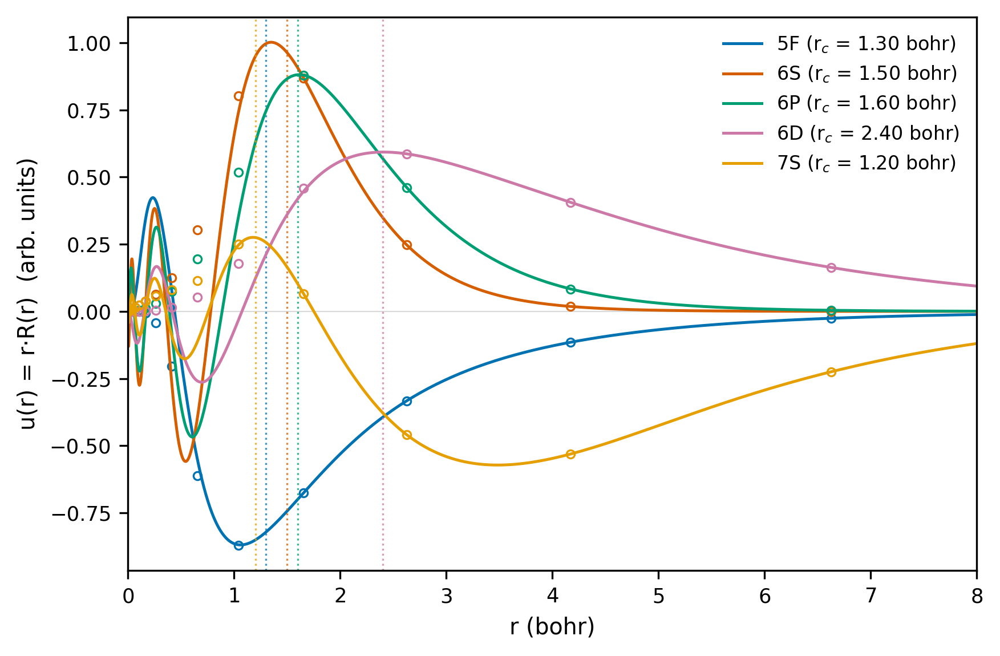
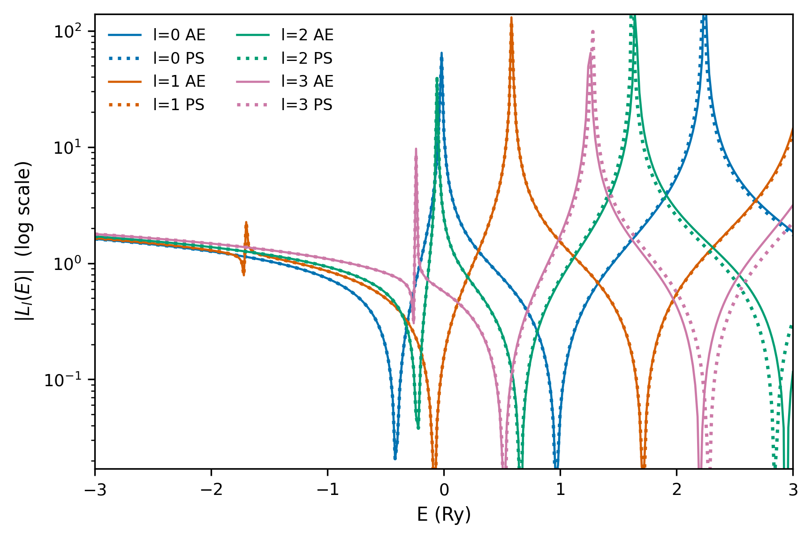
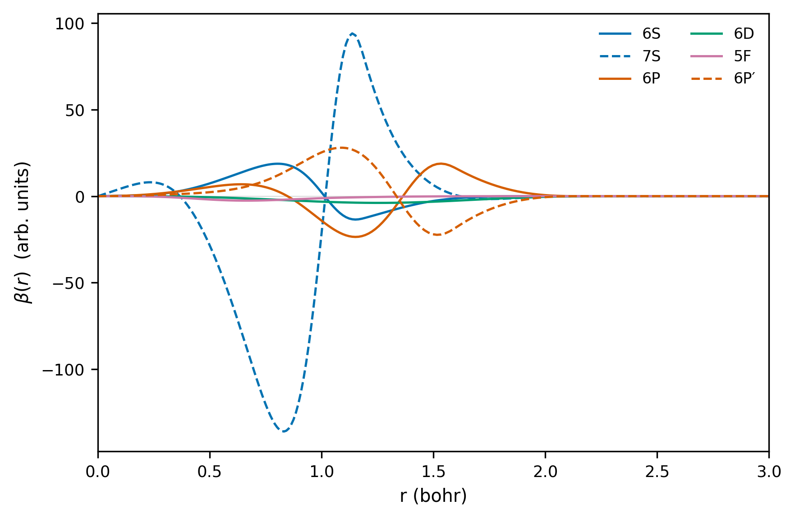

# uranium-14ve-6p25: generation report

U, 14 valence electrons (5f3 6s2 6p6 6d1 7s2), scalar-relativistic, norm-conserving, PBE, Troullier-Martins, with a sixth (unoccupied) 6P projector.

- AiiDA group: `aiida-ld1-6p25`
- generation: pk 561461
- transferability: pk 561503
- rlderiv scan: 5 point(s)
- criteria: window [-3.0, 3.0] Ry, pole threshold |L| > 20.0, pole tolerance 0.04 Ry

## The pseudopotential

| field | value |
|---|---|
| element | U |
| pseudo_type | NC |
| relativistic | scalar |
| functional | PBE |
| z_valence | 14.000000000000000 |

Etot = -55958.130614 Ry, Etotps = -181.732842 Ry

## Bound-state energies

The pseudo-atom reproduces the all-electron levels of the generating configuration:

| orbital | n | l | occ | e AE (Ry) | e PS (Ry) | delta (mRy) |
|---|---|---|---|---|---|---|
| 5F | 4 | 3 | 3 | -0.24562 | -0.24553 | -0.08 |
| 6S | 1 | 0 | 2 | -3.51754 | -3.51759 | +0.05 |
| 6P | 2 | 1 | 6 | -1.70801 | -1.70802 | +0.01 |
| 6D | 3 | 2 | 1 | -0.17091 | -0.17091 | +0.00 |
| 7S | 2 | 0 | 2 | -0.31116 | -0.31116 | +0.00 |

Worst mismatch: **0.08 mRy**.

## Radial functions

Inside a state cut-off radius the pseudo orbital is *meant* to differ from the all-electron one (that is the pseudization); **outside** it the tail must agree, otherwise the logarithmic derivative and the transferability are wrong. Columns are `max |u_AE - u_PS|` before and after the cut-off (phase aligned, see `analysis.align_phase`).

| orbital | rcut (bohr) | inside | outside | phase flipped |
|---|---|---|---|---|
| 5F | 1.3 | 0.4570 | 1.70e-05 | no |
| 6S | 1.5 | 0.7725 | 9.44e-04 | yes |
| 6P | 1.6 | 0.6420 | 2.69e-05 | no |
| 6D | 2.4 | 0.3299 | 3.39e-06 | yes |
| 7S | 1.2 | 0.2732 | 4.38e-04 | yes |

Worst tail mismatch: **9.44e-04**.

## Logarithmic derivatives and poles

No point is dropped from `median |dL|`; the median is robust to the few energies at a pole where both curves diverge (`max |dL|` is dominated by them and cannot compare two points).

Two caveats on the pole columns, both measured rather than assumed:

* the poles of `L(E)` at radius `r_c` are the **box** spectrum of that radius (`u(r_c, E) = 0`), not properties of the atom -- they move with `r_c` by construction, so pole *counts* are only comparable at one radius;
* whether a divergence is detected at all depends on its residue: a pole whose `|L|` peak falls between two grid points stays under the `|L| > 20` threshold. Measured on the same all-electron atom, the detected `l=0` pole count is **1 at rlderiv = 4 and 2 at rlderiv = 5**.

So a pole verdict is meaningful **within one radius** (AE and PS are then solved in the same box) and not across radii.

| channel | median |dL| | max |dL| | poles AE / PS | coincide |
|---|---|---|---|---|
| l=0 | 2.327e-03 | 4.720e+02 | 2 / 2 | yes |
| l=1 | 8.121e-05 | 9.416e+00 | 1 / 1 | yes |
| l=2 | 2.454e-03 | 6.997e+02 | 2 / 2 | yes |
| l=3 | 1.093e-03 | 1.061e+02 | 1 / 1 | yes |

Poles coincide in every channel: **yes**.

## Transferability (error in the energy differences)

`Delta E = (E_ae - E_ae,ref) - (E_ps - E_ps,ref)` against the generating configuration. For a pseudopotential this is the number that matters: an error that cancels between configurations does not affect energy differences.

| # | configuration | dE_AE (Ry) | dE_PS (Ry) | Delta E (mRy) |
|---|---|---|---|---|
| 1 | 5f3 6s2 6p6 6d1 7s2 | +0.000000 | +0.000000 | +0.0 |
| 2 | 5f3 6s2 6p6 6d0 7s2 | +0.396703 | +0.397216 | -0.5 |
| 3 | 5f3 6s2 6p6 6d1 7s1 | +0.492878 | +0.493174 | -0.3 |
| 4 | 5f3 6s2 6p6 6d2 7s1 | +0.145115 | +0.145599 | -0.5 |
| 5 | 5f3 6s2 6p6 6d2 7s0 | +0.604081 | +0.605156 | -1.1 |

Worst |Delta E| = **1.07 mRy = 14.6 meV**.

This is an **atomic** configuration energy difference. It is *not* the ACWF `delta`, which is defined on a solid's energy-volume curve in meV/atom, so the two cannot be compared directly -- and the unit conversion matters: 1 mRy = 13.6 meV, so 1/3 meV = 0.0245 mRy (not 0.333 mRy, which would be 4.5 meV). As an external scale, chemical accuracy is about 43 meV (1 kcal/mol), i.e. this pseudopotential is at roughly a third of it on the worst configuration.

## The rlderiv scan: a diagnostic, not a selection

One full generation per value. **The pooled median cannot rank these points**, and it is not because the pseudopotentials are equally good: at a larger radius `L(E)` is dominated by the decaying tail (`u'/u -> -kappa + 1/r`), where the all-electron and pseudo curves agree by construction. The metric therefore measures mostly *how far outside the core it looks* -- measured at `E = -1 Ry`, `|L_AE - L_PS|` is 5.9e-05 at rlderiv = 4 and 3.6e-07 at rlderiv = 8.

The pole verdict is the hard criterion (a pseudopotential that adds or moves a bound state is not made acceptable by a small median), so it gates the choice. `bound median` repeats the median on `E < 0` only, where the tail cannot do the work; it is shown as a sanity check, not as a second criterion.

| rlderiv | l=0 median | l=1 median | l=2 median | l=3 median | pooled median | bound median | poles coincide |
|---|---|---|---|---|---|---|---|
| 4 | 8.854e-04 | 1.484e-04 | 2.797e-03 | 3.871e-03 | 8.775e-04 | 8.27e-05 | **NO** |
| 5 | 2.327e-03 | 8.121e-05 | 2.454e-03 | 1.093e-03 | 1.031e-03 | 1.20e-05 | yes |
| 6 | 6.382e-04 | 1.065e-04 | 5.529e-04 | 4.119e-04 | 5.648e-04 | 4.92e-06 | **NO** |
| 7 **←** | 2.847e-04 | 2.856e-04 | 2.043e-04 | 1.784e-04 | 2.359e-04 | 2.54e-06 | yes |
| 8 | 1.667e-04 | 1.407e-04 | 1.132e-04 | 7.642e-05 | 1.376e-04 | 8.11e-06 | **NO** |

**Pole-gated pick: rlderiv = 7 bohr** (pooled median 2.359e-04, pk 561489); the points passing the pole test are 5, 7.
The smallest median is rlderiv = 8 (1.376e-04), but its pole check **fails**, so it is not admissible -- ranking by the median alone is what an earlier version of this report did.

The production pseudopotential uses the recipe value (`rlderiv = 5.0`); this scan does not justify changing it.

## Figures

All-electron orbitals as solid lines, pseudo-orbitals as open symbols; the vertical dotted lines are the pseudization radii. The all-electron core states (4F, 5D) have no pseudo-orbital and are not drawn.

All-electron curves solid, pseudo curves dotted, one colour per angular momentum channel; `|L|` on a logarithmic axis, so a pole is an upward spike and a zero a downward one. Pole correspondence is in the table above, not marked on the figure.

The six radial projector functions `beta(r)`, coloured by angular momentum (the two channels with two projectors, `l = 0` and `l = 1`, use a solid and a dashed line), amplitude in arbitrary units.

